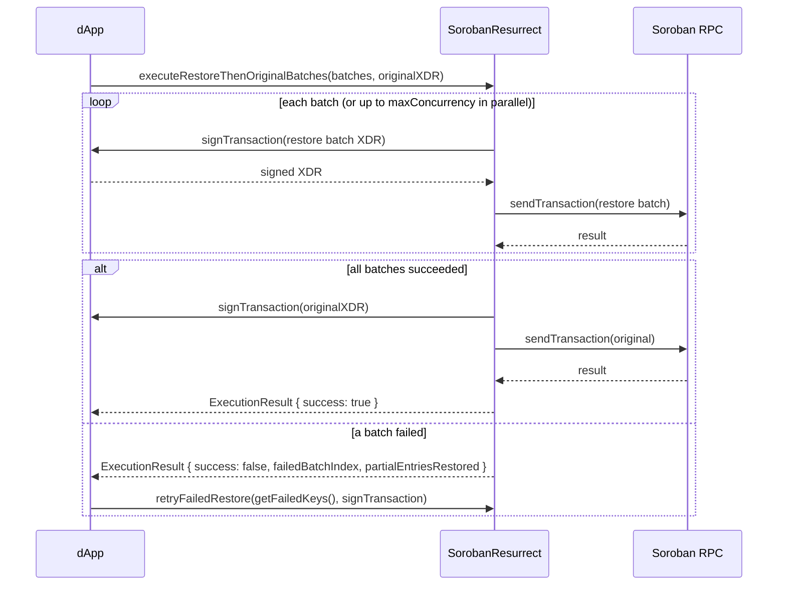

# Multi-Batch and Concurrent Restoration

This guide is for dApp developers who restore archived state. It covers when the SDK
uses one transaction, sequential batches, or concurrent batches; what each restore
transaction costs; and how to recover when a batch fails.

## Result types at a glance

| Mode | Entry point | Result type | Failure fields |
|------|-------------|-------------|----------------|
| Sequential multi-batch | `executeRestoreThenOriginalBatches` | `RestoreAllBatchesResult` | `failedAtBatchIndex` |
| Concurrent multi-batch | `executeRestoreThenOriginalBatchesConcurrent` | `ConcurrentRestoreResult` | `failedBatchCount`, `failedBatchIndices`, `concurrencyUsed` |

Both are wrapped in `ExecutionResult`, which exposes `batchResults` (sequential) or
`concurrentBatchResults` (concurrent), plus `failedBatchIndex` and
`partialEntriesRestored` when a restore stops partway.

## Decision tree

```
Archived keys found?
├── No  → submit the original transaction
└── Yes → how many keys?
          ├── ≤ maxRestoreBatchSize (default 50) and within maxRestoreFeeStroops
          │     → 1 restore transaction, then the original transaction
          └── More than one batch
                ├── Batches are independent and you want lower latency
                │     → executeRestoreThenOriginalBatchesConcurrent
                │       (up to maxConcurrency batches in flight)
                └── Otherwise
                      → executeRestoreThenOriginalBatches (one batch at a time)
```

### Configuration knobs

- **`maxRestoreBatchSize`** (default `50`): maximum keys per restore transaction.
- **`maxRestoreFeeStroops`** (optional, needs `dynamicFeeEstimation`): fee budget per
  batch. Batching stops adding keys once the estimated fee would exceed it.
- **`maxConcurrency`**: in-flight batch limit for concurrent mode. Override per call
  with `options.concurrency`.

A batch boundary is set by whichever limit is hit first.

## Fee math

Each batch is a separate transaction, so each carries its own base fee and resource
fee. For a batch of `n` keys:

```
batchFee ≈ estimateRestoreFee(n)
totalFee  = Σ batchFee over all batches
```

`estimateRestoreFee(batchSize)` returns the estimate for one batch. Splitting 300 keys
into six batches of 50 pays six base fees. Use `maxRestoreFeeStroops` to cap
per-batch spend.

## Example: sequential restore

```typescript
import { SorobanResurrect } from '@soroban-resurrect/sdk'

const client = new SorobanResurrect({
  rpcUrl: 'https://soroban-testnet.stellar.org',
  networkPassphrase: 'Test SDF Network ; September 2015',
  maxRestoreBatchSize: 50,
})

const result = await client.executeRestoreThenOriginalBatches(
  restoreBatches,
  originalXDR,
  signTransaction,
)

if (!result.success) {
  console.log(result.failedBatchIndex)           // first failing batch (0-based)
  console.log(result.partialEntriesRestored)     // keys restored before the failure
  console.log(result.batchResults?.failedAtBatchIndex)
}
```

## Example: concurrent restore

```typescript
const result = await client.executeRestoreThenOriginalBatchesConcurrent(
  archivedKeys,
  originalXDR,
  sourceAccountID,
  signTransaction,
  { requireAllBatches: true, concurrency: 4 },
)

const concurrent = result.concurrentBatchResults
if (concurrent && !concurrent.success) {
  console.log(concurrent.failedBatchCount)
  console.log(concurrent.failedBatchIndices)
  console.log(concurrent.concurrencyUsed)
}
```

## Failure semantics

| Option | Behavior |
|--------|----------|
| `requireAllBatches: true` (default) | The original transaction is not submitted if any batch fails. |
| `requireAllBatches: false` | The original transaction is submitted anyway. It may still fail if the unrestored keys are needed. |

In sequential mode, batches after `failedAtBatchIndex` are never submitted. In
concurrent mode, batches already in flight may succeed even when others fail, which
is why `failedBatchIndices` lists exactly which ones to retry.

### Resuming after a partial failure

When a restore fails partway, the SDK stores the unfinished work:

```typescript
const state = client.getFailedKeys()   // FailedRestoreState | null

if (state) {
  const retried = await client.retryFailedRestore(state, signTransaction)
  if (!retried.success) {
    // Inspect retried.partialEntriesRestored and try again later.
  }
}
```

`FailedRestoreState` contains `failedBatches` (the exact `RestoreBatchResult` objects
to resubmit), `failedKeys` (flattened, for logging and UX), `failedBatchIndex`, and
`partialEntriesRestored`.

## React StrictMode and duplicate restore side effects

React 18+ StrictMode intentionally mounts, unmounts, and remounts components in
development so effects run twice. If you kick off a restore from a `useEffect`, the
second invocation can submit the same restore batches again — paying duplicate fees
and racing two restore transactions for the same keys.

Restore operations are **idempotent at the SDK level**: restoring a key that is
already live is a no-op on-chain, so a duplicate restore will not corrupt state. It
can still waste fees and produce confusing logs, so the SDK deduplicates concurrent
restore calls for the same keys.

### Deduplication behavior

- **In-flight dedup:** while a restore for a given set of keys is in flight, a second
  call with the same keys joins the existing operation and resolves with the same
  `ExecutionResult` instead of submitting new transactions.
- **Completed dedup:** once a restore completes successfully, a repeat call for the
  same keys short-circuits and returns the cached success result without new
  transactions.
- **Failure is not cached:** if a restore fails, the next call retries normally (use
  `getFailedKeys` / `retryFailedRestore` for explicit recovery).
- **Cleanup:** aborting or unmounting does not cancel an in-flight restore; the
  operation completes and its result is cached so a remount reuses it.

### Recommended pattern

Guard the effect so a remount does not start a second restore, and let the SDK's
dedup handle the StrictMode double-invoke:

```typescript
useEffect(() => {
  let cancelled = false
  client
    .executeRestoreThenOriginalBatches(restoreBatches, originalXDR, signTransaction)
    .then((result) => {
      if (!cancelled) setResult(result)
    })
  return () => {
    cancelled = true
  }
}, [restoreBatches, originalXDR])
```

Because the SDK deduplicates identical in-flight restores, the StrictMode remount
joins the first operation rather than submitting a second set of batches. Keep the
`cancelled` flag to avoid setting state on an unmounted component; it does not affect
the restore itself.

### Edge cases

| Scenario | Behavior |
|----------|----------|
| Rapid mount/unmount/remount | Second effect joins the in-flight restore; one set of transactions. |
| Concurrent calls with identical keys | Deduplicated to a single restore operation. |
| Concurrent calls with different keys | Treated as independent restores; not deduplicated. |
| Retry after failure | Not deduplicated against the failed attempt; a fresh restore runs. |

## Sequence diagram


